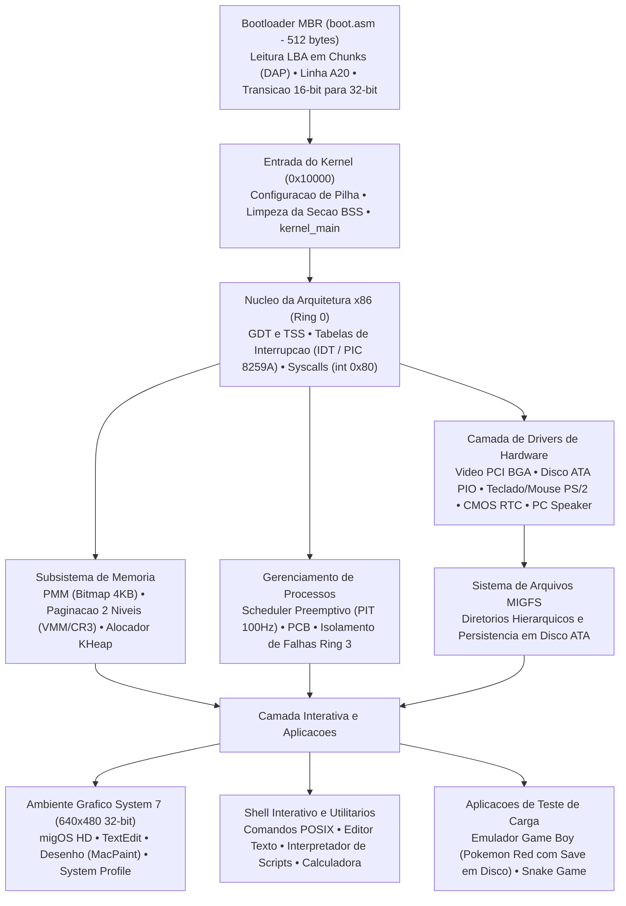

# migOS — Sistema Operacional Educacional x86 (IA-32)

O **migOS** é um sistema operacional monolítico de 32 bits desenvolvido inteiramente do zero (*bare-metal*) para a arquitetura x86, utilizando C (padrão GNU99 *freestanding*) e Assembly NASM.

O projeto foi concebido na disciplina de **Sistemas Operacionais (2026)** com o propósito de investigar, na prática, todas as camadas que sustentam o funcionamento de um computador moderno. Em vez de recorrer a bibliotecas prontas do sistema hospedeiro ou a gerenciadores de inicialização de terceiros, cada etapa — desde os primeiros 512 bytes executados pela BIOS até o escalonador de processos e a interface gráfica — foi projetada e implementada manualmente sobre o hardware.

---

## O Bootloader Próprio (MBR) e a Inicialização sem GRUB

Um dos diferenciais técnicos mais importantes do **migOS** é não depender do GRUB ou do protocolo Multiboot. Todo o processo de partida da máquina foi construído manualmente no arquivo `boot/boot.asm`, respeitando o limite estrito de **512 bytes** do setor mestre de inicialização (MBR), encerrado pela assinatura `0xAA55`.

Quando o processador inicia em **Modo Real de 16 bits** no endereço físico `0x7C00`, o bootloader executa uma sequência crítica de engenharia:

1. **Superação do Limite de Segmentação de 16 bits via LBA em Chunks**:
   À medida que o kernel evoluiu para incluir subsistemas gráficos, drivers e aplicações integradas, seu binário atingiu 512 KB (1.024 setores). Em Modo Real de 16 bits, uma leitura única via BIOS falharia ao cruzar fronteiras de segmento de 64 KB. Para solucionar esse problema dentro dos 512 bytes do MBR, foi implementado um carregador baseado na extensão LBA da BIOS (`INT 0x13, AH=0x41` e `AH=0x42`) operando com uma estrutura **DAP (*Disk Address Packet*) de 16 bytes**. O bootloader realiza 16 leituras sucessivas em blocos seguros de 64 setores (32 KB por iteração), avançando dinamicamente o ponteiro de setor LBA e deslocando o segmento de destino em `0x0800` a cada ciclo, posicionando todo o kernel a partir do endereço físico `0x10000` enquanto exibe o progresso na tela via `INT 0x10`.
2. **Desbloqueio da Linha A20**:
   Ativa o *Fast A20 Gate* através da porta de I/O `0x92`, permitindo que o processador acesse endereços acima do primeiro megabyte de memória RAM sem sofrer envelopamento de endereço (*wrap-around*).
3. **Configuração da GDT Inicial e Transição para Modo Protegido (32 bits)**:
   Após desativar as interrupções da BIOS (`cli`), o bootloader carrega uma *Global Descriptor Table* (GDT) plana no registrador `GDTR`, ativa o bit de proteção (`PE`) no registrador de controle `CR0` e executa um salto longo (`jmp 0x08:protected_mode_start`). Esse salto limpa o pipeline de instruções de 16 bits da CPU, configura os registradores de segmento de 32 bits, estabelece a pilha inicial e transfere a execução diretamente para o ponto de entrada do kernel em `0x10000`.

---

## Arquitetura do Kernel e Pilares de Sistemas Operacionais

Uma vez em Modo Protegido de 32 bits, o núcleo do sistema assume o controle do hardware e inicializa os subsistemas fundamentais estudados na literatura de Sistemas Operacionais:

### 1. Gerenciamento de Memória (PMM, Paginação x86 e KHeap)
A memória RAM é administrada em três níveis complementares:
- **Physical Memory Manager (PMM)**: Utiliza um mapa de bits (*bitmap*) para controlar quadros físicos (*frames*) de 4 KB, preservando a memória baixa e as regiões reservadas de hardware.
- **Virtual Memory Manager (VMM) e Paginação de Dois Níveis**: Ativa a paginação por hardware no registrador `CR0` (`CR0.PG = 1`) e gerencia diretórios e tabelas de páginas via registrador `CR3`. Isso garante que cada processo de usuário enxergue seu próprio espaço de endereçamento virtual isolado, além de mapear o *Linear Framebuffer* de vídeo (`0xFD000000`) sem conflitos.
- **Alocador Dinâmico do Kernel (KHeap)**: Implementa `kmalloc`, `kfree`, `kcalloc` e `krealloc` sobre uma lista duplamente encadeada de blocos com cabeçalhos validados por assinatura mágica (`0x1A2B3C4D`), divisão automática de blocos (*splitting*), fusão imediata de blocos livres adjacentes (*coalescing*) para evitar fragmentação externa e expansão sob demanda junto ao PMM.

### 2. Multitarefa Preemptiva e Escalonamento
O sistema utiliza o temporizador programável **PIT 8254** configurado a **100 Hz** (uma interrupção `IRQ0` a cada 10 ms) para acionar o escalonador preemptivo (*Round-Robin*).
Cada tarefa é representada por um *Process Control Block* (`task_t` / PCB) que preserva o contexto completo dos registradores, estado de execução (`RUNNING`, `READY`, `SLEEPING`, `BLOCKED`, `ZOMBIE`), pilhas de execução e seu próprio diretório de páginas (`CR3`). A troca de contexto ocorre de forma atômica em Assembly durante o retorno da interrupção de relógio.

### 3. Isolamento de Privilégio (Ring 0 vs. Ring 3) e Chamadas de Sistema
A arquitetura utiliza seis descritores na GDT e um *Task State Segment* (TSS) para separar o núcleo privilegiado (**Ring 0**) das aplicações de usuário (**Ring 3**):
- **Barreira de Syscalls (`int 0x80`)**: Programas em Ring 3 não têm acesso direto ao hardware; eles solicitam serviços ao kernel por meio da interrupção de software `0x80` (configurada com `DPL = 3`), passando por validação estrita de ponteiros e limites de memória.
- **Isolamento de Falhas (*Fault Isolation*)**: Se um processo em Ring 3 tentar executar uma instrução privilegiada (como `cli` ou `inb`) ou acessar páginas exclusivas do kernel, o processador dispara uma exceção (`#GP` ou `#PF`). O tratador de interrupções do migOS identifica que a falha partiu do modo usuário, exibe o diagnóstico técnico e encerra **apenas o processo infrator** (*Segmentation Fault*), mantendo o sistema operacional e o terminal intactos.

### 4. Sistema de Arquivos Hierárquico e Persistente (MIGFS)
Em vez de operar apenas em memória volátil, o migOS implementa um driver de disco rígido **ATA/IDE (modo PIO)** que lê e grava setores LBA diretamente no disco virtual. Sobre esse driver opera o **MIGFS**, um sistema de arquivos próprio com suporte a árvore de diretórios (`mkdir`, `cd`, `pwd`, `mv`, `cp`, `rm`), persistência automática de dados entre reinicializações e registro de data e hora reais obtidos pelo driver **CMOS/RTC** da placa-mãe.

### 5. Drivers de Dispositivos e Biblioteca C Própria
Todo o suporte a periféricos foi escrito diretamente sobre portas de entrada/saída (`inb`/`outb`, `inw`/`outw`, `inl`/`outl`) e interrupções remapeadas no controlador **PIC 8259A**:
- **Vídeo Bochs/QEMU BGA**: Varredura do barramento PCI para localização do *Linear Framebuffer* (`BAR0`) e renderização em **640x480 a 32 bits por pixel (True Color)** com *double buffering* em RAM para eliminar cintilação.
- **Teclado e Mouse PS/2**: Tratamento assíncrono via `IRQ1` e `IRQ12`, com decodificação de *scancodes* (incluindo teclas estendidas) e pacotes de movimentação/clique de 3 bytes.
- **Áudio via PC Speaker**: Síntese de ondas quadradas pelo Canal 2 do PIT 8254 e porta `0x61`, fornecendo efeitos sonoros de sistema e som de inicialização.
- **Freestanding LibC**: Implementação própria de funções essenciais da linguagem C (`printf`, `snprintf`, `sscanf`, `memcpy`, `memset`, `strcmp`, `strtol`, `qsort`, manipulação de tempo UNIX, entre outras) sem dependência de bibliotecas externas.

---

## Ambiente Gráfico, Aplicações e Emulação Bare-Metal

Para demonstrar a capacidade dos subsistemas de memória, vídeo, entrada e disco trabalhando em conjunto sob carga real, o migOS oferece tanto um ambiente de linha de comando avançado quanto uma interface gráfica completa:

- **Interface Gráfica Inspirada no Mac OS System 7 (640x480 @ 32-bit)**:
  Acessível pelo comando `gui`, apresenta barra de menus superior fixa, relógio em tempo real conectado ao CMOS/RTC, ícones na área de trabalho e janelas móveis com estética clássica. Inclui o gerenciador de arquivos gráfico **migOS HD**, o editor de documentos **TextEdit**, a janela de diagnóstico **System Profile** e o software de pintura **Desenho** (inspirado no *MacPaint* de 1984, com algoritmo de linha de Bresenham, borracha, ajuste de espessura e paleta de 16 cores).
- **Emulador de Game Boy Bare-Metal (Executando Pokémon Red)**:
  O núcleo do emulador *Peanut-GB* foi portado e integrado diretamente ao ambiente *freestanding* do kernel, permitindo executar ROMs comerciais de Nintendo Game Boy (como **Pokémon Red**) a 60 quadros por segundo. O progresso salvo pelo jogador dentro do jogo é gravado em arquivos `.sav` no sistema de arquivos MIGFS sobre o disco ATA, preservando o estado entre diferentes sessões de uso da máquina virtual.
- **Terminal Interativo de Alta Resolução e Ferramentas de Produtividade**:
  O terminal opera em modo gráfico de 80x30 caracteres com histórico contínuo de 120 linhas, barra de rolagem lateral controlada pelo mouse ou teclado, preenchimento automático com `Tab`, editor de texto em tela cheia (`edit` / `nano`), interpretador de scripts em lote (`run <script.txt>`) e avaliador de expressões matemáticas com analisador sintático descendente recursivo (`calc`).

---

## Diagrama Geral da Arquitetura



---

## Roteiro Sugerido para Demonstração e Avaliação

Ao iniciar o sistema, o terminal interativo estará disponível imediatamente. Abaixo estão os comandos mais representativos para avaliar os diferentes aspectos do projeto:

1. **Inspeção de Processos, Paginação e Isolamento de Falhas (Ring 0 vs. Ring 3)**:
   - `ps` — Lista os processos ativos, seus identificadores (PID), estado, nível de privilégio (Ring 0/3) e diretório de páginas (`CR3`).
   - `pages` — Exibe o mapeamento ativo da paginação de dois níveis da arquitetura x86.
   - `ring3` — Inicia um processo em modo usuário restrito (Ring 3) que interage com o kernel exclusivamente via chamadas de sistema (`int 0x80`).
   - `faultdemo` e `gpfdemo` — Demonstram a proteção por hardware: um processo em Ring 3 tenta violar a memória do kernel (`#PF`) ou executar uma instrução privilegiada (`#GP`). O sistema operacional intercepta a exceção, exibe o relatório do registrador `CR2` e encerra apenas o processo infrator, mantendo o kernel estável.

2. **Interface Gráfica e Aplicações Visuais**:
   - `gui` — Inicia o ambiente gráfico 640x480 em 32 bits. A partir dele é possível abrir o gerenciador de arquivos **migOS HD**, criar textos no **TextEdit**, utilizar o aplicativo **Desenho** (`paint`) ou consultar o **System Profile**.

3. **Persistência de Arquivos e Ferramentas de Terminal**:
   - `free` e `df` — Apresentam métricas detalhadas de ocupação da memória RAM (PMM/KHeap) e do disco rígido ATA.
   - `mkdir`, `cd`, `ls`, `edit <arquivo>`, `cat <arquivo>` — Permitem testar a criação e edição de diretórios e arquivos reais gravados em disco.
   - `calc (25 + 15) * 4 / 2` — Executa o motor de análise sintática matemática integrado ao shell.

4. **Emulação Bare-Metal**:
   - `pokemon` — Inicia o emulador de Game Boy executando *Pokémon Red* diretamente no kernel, com suporte a salvamento persistente em disco (`F5` para gravar o estado e `Esc` para retornar ao sistema).

---

## Estrutura de Diretórios

```text
MigelSO/
├── boot/
│   └── boot.asm            # Bootloader MBR de 512 bytes (16-bit Real Mode -> 32-bit Protected Mode)
├── include/                # Interfaces públicas e cabeçalhos (.h) de todos os subsistemas
├── kernel/
│   ├── kernel.c            # Ponto de entrada C (kernel_main) e orquestração de inicialização
│   ├── arch/i386/          # Estruturas da CPU: GDT, TSS, IDT, ISRs, PIC 8259A, PIT 8254 e Reboot
│   ├── memory/             # Gerenciadores de memória física (PMM), virtual (VMM) e dinâmica (KHeap)
│   ├── task/               # Escalonador preemptivo Round-Robin e controle de processos (PCB)
│   ├── syscall/            # Despachante de chamadas de sistema (int 0x80) e validação de buffers
│   ├── drivers/            # Drivers de hardware: Vídeo BGA, Disco ATA, Teclado, Mouse, RTC e Áudio
│   ├── fs/                 # Implementação do sistema de arquivos hierárquico e persistente MIGFS
│   ├── gui/                # Subsistema gráfico Mac OS System 7 e aplicações integradas
│   ├── emulator/           # Port bare-metal do emulador de Game Boy (Peanut-GB)
│   ├── editor/             # Editor de texto em tela cheia para o terminal
│   ├── interpreter/        # Interpretador de scripts .txt e avaliador de expressões aritméticas
│   └── games/              # Implementação nativa do jogo Snake
├── libc/                   # Biblioteca C freestanding (stdio, stdlib, string, time)
├── shell/                  # Interpretador de comandos interativo (CLI)
├── linker.ld               # Script do GNU Linker para alinhamento de seções a partir de 0x10000
└── build.ps1               # Automação de montagem, compilação, geração de imagem e execução no QEMU
```

---

## Compilação e Execução

O projeto dispõe de um script de automação em PowerShell (`build.ps1`) que realiza a montagem dos arquivos Assembly com o NASM, compila os módulos C com as flags `-m32 -ffreestanding -fno-builtin -nostdlib`, realiza a linkagem via `linker.ld`, constrói a imagem de disco unificada `migOS.img` (combinando o MBR no setor 0, o binário do kernel alinhado e a partição de dados do MIGFS) e inicia o emulador QEMU.

### Pré-requisitos (Ambiente Windows)
- **GCC** com suporte a geração de código de 32 bits (`i686` / `-m32`) e **GNU Binutils** (`ld`, `objcopy`), disponíveis via MinGW-w64 ou MSYS2.
- **QEMU** (`qemu-system-i386` ou `qemu-system-x86_64`).
- **NASM** (o binário portátil `nasm.exe` já acompanha a raiz do projeto).

### Comandos de Execução

Para compilar todo o código-fonte e iniciar imediatamente a máquina virtual:

```powershell
.\build.ps1
```

Para apenas compilar e gerar a imagem de disco `migOS.img` sem iniciar o emulador:

```powershell
.\build.ps1 -NoRun
```

---

## Autor

Desenvolvido por **Miguel Pereira** como projeto prático da disciplina de **Sistemas Operacionais (2026)**, com foco na compreensão aprofundada de programação em baixo nível, arquitetura de processadores x86, gerência de memória e construção de sistemas operacionais.
